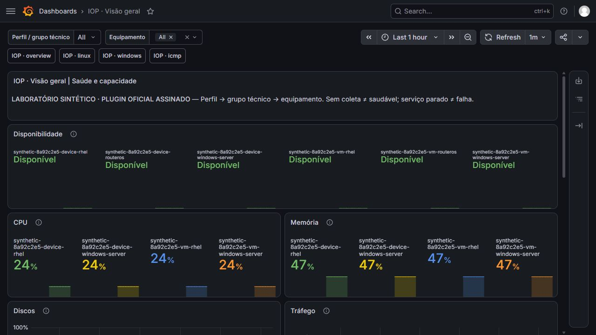

# Teste isolado dos grupos técnicos no Grafana

Resultado aprovado no ensaio isolado de 7 de novembro de 2026. Nenhum acesso ou implantação no LAB01 ou OPS foi realizado. A mudança é proposta em PR de rascunho, sem aceite de implantação.

## Ambiente e escopo

A cópia partiu da revisão `60162d49b5749049aa288b4d2a08b69850dc63ac` e incorporou os ajustes locais pertinentes da sincronização, sem modificar a origem. Foram conferidos 437 arquivos, HEAD e índice Git ao final.

O ensaio criou uma stack nova com NetBox, Zabbix e Grafana na VM descartável. O plugin oficial Zabbix 6.10.2 apresentou assinatura `valid`; não foi utilizada a compilação de desenvolvimento nem exceção para plugin não assinado. As consultas da fonte utilizaram HTTPS com CA e hostname validados e conta Zabbix somente de leitura. As 41 verificações ocorreram entre 04:38 e 04:45 UTC (01:38 a 01:45 em America/Sao_Paulo).

## Resultados

| Verificação | Observado | Resultado |
|---|---|---|
| Contratos offline | 13 casos técnicos, 14 de transição e 21 do campo personalizado | 48 passaram |
| Guards Ansible | Instalação, preservação, extensão, desativação e remapeamento | 6 cenários passaram |
| Renderização | Padrão sem novas variáveis; opt-in com mapa esperado; sem portas adicionais | Passou |
| APIs reais | 41 verificações funcionais, incluindo dry-run, guard e idempotência | Passaram |
| Adoção | 6 hosts sintéticos receberam um grupo técnico, mantendo o grupo local | Passou |
| Consultas antes da transição | Linux 2, Windows 2, ICMP 2, sem `hostTags` | Passou |
| Transição de dois objetos | Mesmos hostid, interfaceid e itens; histórico real do item testemunha manteve valor 42; tags e macros locais preservadas | Passou |
| Consultas após a transição | Linux 2, Windows 4, ICMP 0 | Passou |
| Repetição | Zero escritas adicionais | Passou |
| Segurança da fonte | CA errada e hostname errado recusados; escrita recusada com HTTP 403 | Passou |
| Dashboards | Quatro importados; seis dashboards preexistentes da fixture permaneceram iguais | Passou |
| Escopo | Hosts não pertencentes ao teste e estado dos containers externos preservados; sem alteração na lista de alertas | Passou |

## Conferência visual

Os quatro dashboards foram conferidos no navegador real com usuário Viewer: visão geral, Linux, Windows e ICMP. O seletor da visão geral passou de seis hosts para somente os dois Windows; o seletor de equipamentos acompanhou o perfil. A seleção de um equipamento ICMP restringiu os painéis ao host escolhido.

As séries fictícias exibiram CPU 24%, memória 47%, disco 38%, tráfego 12 kb/s, latência 12 ms e perda 0%. O painel Windows exibiu os dois serviços fictícios em execução. A visão geral recebeu uma linha inteira de disponibilidade para evitar nomes e valores cortados.

A fase visual foi assistida, não um teste automático de browser no CI. Somente os seis hosts de propriedade comprovada foram temporariamente habilitados. Doze itens ICMP herdados desses hosts foram temporariamente desabilitados para não misturar as falhas reais dos endereços de documentação com as séries trapper fictícias. Os estados originais foram restaurados antes da reconciliação final. Os helpers restritos e snapshots desse estado permanecem no pacote privado da execução.

As capturas abaixo são reais, somente com dados fictícios, sem edição de pixels. O [resumo sanitizado](../evidence/grafana-technical-groups/result.sanitized.json) contém a sequência das 41 verificações e os hashes das imagens. Logs privados, credenciais, chaves e inventários não fazem parte da publicação.

[Linux](../evidence/grafana-technical-groups/linux.jpg) · [Windows](../evidence/grafana-technical-groups/windows.jpg) · [ICMP](../evidence/grafana-technical-groups/icmp.jpg) · [Serviços Windows](../evidence/grafana-technical-groups/windows-services.jpg)

## Revisão para publicação

A preparação do PR separou o teste Grafana da matriz funcional existente. O runner passou a construir a imagem a partir de Grafana 13.1.6 e do plugin oficial 6.10.2, sem depender de cache privado. A pausa visual tornou-se opcional, com senha Viewer aleatória e restauração dos estados temporários em `finally`. Nomes técnicos com controles, espaços nas bordas ou `$` são recusados.

Na revisão, 95 testes NetBox offline e 20 testes técnicos/contratos passaram, totalizando 115. Os seis contratos verificam a composição do runner, independência da matriz anterior, seletores e restauração em sucesso/timeout; utilizam mocks e não substituem o ensaio com APIs reais.

Os ajustes de portabilidade e preparação visual não foram reexecutados como stack local nesta revisão. O job `grafana-technical-groups` do CI fará a nova execução automática com a imagem oficial, sem navegador; seu resultado deve ser revisado antes de retirar o PR do rascunho. As capturas e as 41 verificações acima pertencem ao ensaio anterior, não são evidências antecipadas desse CI.

## Limites e limpeza

O ensaio demonstra reconciliação e apresentação de métricas sintéticas. Não valida agentes Linux/Windows reais, disponibilidade dos endereços, serviços reais, alertas completos nem o estado de serviço parado nesta execução. Não é aceite de implantação do LAB01.

O PostgreSQL exclusivo da fixture usou sincronização durável desabilitada para inicialização; não houve teste de queda de energia ou de backup do banco. As rotinas de ativação e rollback estão em [grupos técnicos](../deployment/grafana-technical-profile-groups.md).

Os containers, rede e volumes exclusivos da fixture foram removidos após conferência de propriedade. Os containers externos permaneceram no mesmo estado. As evidências foram arquivadas e a VM descartável foi desligada. Nenhum volume existente do laboratório ou OPS foi removido.

Falhas anteriores de preparação e do roteiro de teste foram preservadas nos logs privados; não foram tratadas como aprovação. A última execução concluiu com `PASS` e limpeza confirmada.
